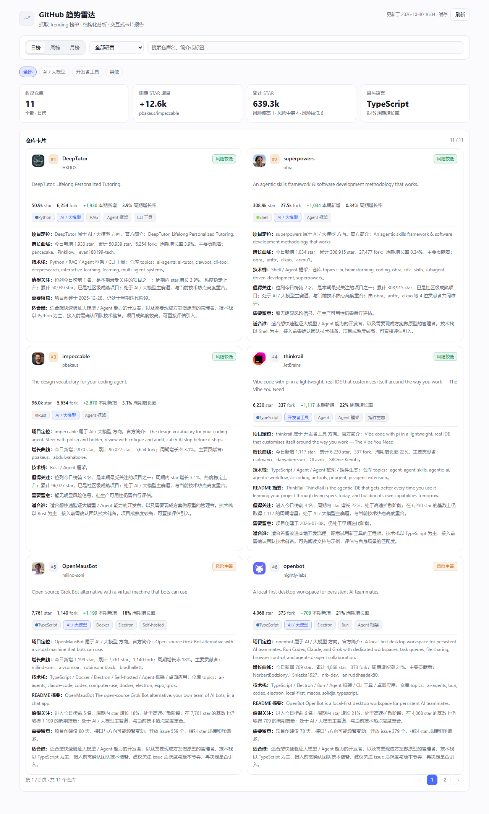

# GitHub 趋势雷达 · dsh-github-trending

[中文](README.md) · [English](README.en.md)

一个可长期安装的 Cordis 插件：抓取 GitHub Trending 日榜 / 周榜 / 月榜（支持按编程语言筛选），
对每个仓库做结构化分析（项目简介、star 增量、核心技术栈、亮点、风险点），
并在 Harness Web UI 里渲染成可浏览、可翻页、可筛选的卡片报告；同时注册工具、命令与 HTTP 路由。

> 关于「dsh-genui」：本 Harness 版本中并不存在名为 `dsh-genui` 的包或服务（已核对 199 个已装配配置项与 host/client 服务目录）。
> 因此本插件自带一套生成式 UI 渲染层：host 侧输出结构化报告数据，client 侧注入 `sidebar.panellist` 图标 + `main` 面板，
> 由 React 组件渲染卡片与分页，效果等同「调用一个 genui 渲染卡片页面」，且不依赖任何未安装的包。



## 功能

- **榜单抓取**：`daily` / `weekly` / `monthly` 三个周期，23 种常用编程语言筛选；解析 star 总数、fork、周期增量、贡献者、语言色。
- **结构化分析**（确定性规则引擎，不额外调用模型）：
  - 项目简介（官方 description + README 摘要清洗）
  - star 增量、周期增长率、日均新增、基数对比
  - 核心技术栈（语言 → 生态、topics → 技术映射、名称/简介/README 关键词）
  - 项目亮点（排名、增速、体量、赛道、贡献者、许可证、活跃度）
  - 风险点与风险等级（star 基数偏小、增速过热、项目过新、归档、license 缺失、issue 积压、单点维护、信息缺失）
  - 分类（AI / 大模型、开发者工具、Web、基础设施、数据、安全、移动、区块链、学习、效率、其他）
- **交互式报告面板**：侧边栏「GitHub 趋势」图标 → 主面板卡片页，含 KPI 概览、周期切换、语言下拉、搜索、分类筛选、
  仓库卡片分页（每页 6 条，卡片直接展示头像、排名、简介、指标、标签与整段分析）。页面只保留这些内容，
  条形图、独立的深度解读专区、图表源码与下载入口都不占版面。
- **报告数据**：`xychart-beta` 增量柱状图与 `pie` 占比的 Mermaid 源码，连同结构化仓库数据一起由
  `GET /dsh-github-trending/report` 的 JSON 返回，供脚本或二次渲染使用；面板本身不展示这些源码。
- **多入口**：工具 `github_trending`、命令 `/github-trending [daily|weekly|monthly] [language]`、`GET /dsh-github-trending/report`。

## 安装

在 DSH 中把本目录安装为 bundle：

```text
plugin_manager(action="install_bundle", target="<绝对路径>/dsh-github-trending")
```

安装会把包写入当前 profile 的 `package.json` 与 `cordis.patch.yml`（`- insert: - id: dsh-github-trending`），
并在 Harness Web UI 中生效：侧边栏出现「GitHub 趋势」面板入口，工具列表出现 `github_trending`，命令面板出现 `/github-trending`。

也可以把本包当作普通 Cordis 插件手动加载，参考 `cordis.yml`。

从 GitHub 安装（仓库根目录即包根，无需构建脚本）：

```text
plugin_manager(action="install_bundle", target="github:Royalsan/dsh-github-trending")
```

从 npm 安装（已发布到 npm registry，无需 git 与构建）：

```text
plugin_manager(action="install_bundle", target="@royalsan/dsh-github-trending")
```

从 GitHub Release 的预构建 tarball 安装（不拉源码、不跑构建，适合网络受限时）：

```text
plugin_manager(action="install_bundle", target="https://github.com/Royalsan/dsh-github-trending/releases/latest/download/dsh-github-trending.tgz")
```

三种来源装的是同一份编译产物；npm 方式走 profile 配置的 registry，国内镜像未同步时可能晚几分钟到几小时。

## 配置

`apply(ctx, config)` 支持以下字段（均有默认值）：

| 字段 | 类型 | 默认 | 说明 |
| --- | --- | --- | --- |
| `token` | string | `$GITHUB_TOKEN` / `$GH_TOKEN` | 可选 GitHub token，用于提升 API 限额（未认证 60 次/小时）。**不要把 token 写进仓库**，用环境变量传入即可 |
| `defaultSince` | `daily`\|`weekly`\|`monthly` | `daily` | 工具/命令未指定周期时使用 |
| `defaultLimit` | number | `15` | 抓取条数（3–25） |
| `defaultFocus` | number | `3` | 深度融合解读的仓库数（1–6） |

在 `cordis.yml` / bundle patch 里写 `config:` 即可覆盖；`token` 建议留给环境变量。

## 使用

```text
/github-trending                       # 今日榜，全语言
/github-trending weekly rust           # 周榜，Rust
```

工具调用等价于：

```json
{ "since": "weekly", "language": "rust", "limit": 20, "focus": 4, "refresh": false }
```

HTTP 路由（同源，供面板与外部脚本使用）：

```text
GET /dsh-github-trending/report?since=daily&language=&limit=15&focus=3&refresh=0
```

返回报告 JSON：`since` / `language` / `generatedAt` / `repos[]`（含分析字段）/ `summary` / `mermaid`。

缓存：报告 10 分钟（同一周期的并发请求会合并），GitHub API 事实 6 小时；命中 403/429 后 5 分钟内跳过增强，
页面仍可用 Trending 页面本身的数据渲染。

## 结构

```
index.js            Host 侧：工具、命令、HTTP 路由（apply 注册，ctx.effect 清理）
client.js           客户端：sidebar.panellist 图标 + main 面板组件（window.__ModuleLoader__）
lib/trending.js     Trending HTML 抓取与解析
lib/http.js         传输层：直连 fetch + Harness web 服务回退
lib/enrich.js       GitHub API + README 增强（并发池、缓存、限流冷却）
lib/analyze.js      分类、技术栈、亮点、风险、深度解读文案
lib/render.js       概览与 Mermaid 图表构建
lib/report.js       编排 + 缓存 + 参数归一化
src/                TypeScript 源码（与 .js 一一对应）
build.mjs           用 node:module stripTypeScriptTypes 生成 .js
test/               宿主端与客户端 smoke 测试、预览页与布局指标采集
```

## 开发

```powershell
node build.mjs                 # src/**.ts → 同名 .js
node test/smoke-host.mjs daily # 宿主端：工具/命令/路由端到端
node test/smoke-client.mjs daily rust   # 客户端：用 React shim 渲染面板并断言
node test/make-preview.mjs daily        # 把面板快照包成可独立打开的预览页
node test/collect-metrics.mjs           # 另开一个终端：采集预览页回传的布局指标
node test/measure-panel.mjs daily       # 或一步到位：起采集器 + 开无头浏览器
```

`test/out/` 下会生成面板 HTML 快照、布局指标与预览图（`panel-*.html` / `panel-*.png`），便于离线检查排版。
预览页用 `--dsw-alias-*` 的回退取值渲染，不依赖 Harness 外壳；布局自检会回传 `overflowX`、卡片列数、KPI 数量等指标，用来发现横向溢出之类的问题。

## 发布（维护者）

发布一个新版本需要四步，顺序不能颠倒：

```powershell
# 1. 升版本号（package.json）后重建编译产物，产物必须进仓库
node build.mjs

# 2. 打 tag 并推送
git tag v1.0.0 ; git push origin main --tags

# 3. 打 tarball 并发布到 npm（包名带 scope，access 已在 publishConfig 里设为 public）
npm pack --pack-destination dist
npm publish --registry https://registry.npmjs.org/

# 4. 把 tarball 作为 Release 附件上传
#    资产名必须是不带版本号的 dsh-github-trending.tgz，
#    市场条目用的是 releases/latest/download/dsh-github-trending.tgz 这个固定地址
Copy-Item dist/royalsan-dsh-github-trending-<version>.tgz dist/dsh-github-trending.tgz
gh release create v1.0.0 dist/dsh-github-trending.tgz --title v1.0.0 --notes "..."
```

没有 `gh` 时，在 GitHub 网页上「Releases → Draft a new release」创建 `v1.0.0`，把 `dist/dsh-github-trending.tgz` 拖进附件区即可。
`repository` 字段已指向本仓库，npm 上架后会被插件市场自动关联（条目里**不要**手写 `npm:` 键）。

## 说明

- 数据来源为 `github.com/trending` 页面（榜单项数量随 GitHub 返回变化，通常 10–16 条）。
- star 增量为页面给出的周期内新增值；分析文案由规则引擎生成，用于快速筛选，不构成选型或投资建议。
- 未认证时 GitHub API 限额较低，插件会自动降级：仅缺失 topics/license/issue/README 等增强信息，核心榜单与增长率不受影响。
- 网络受限环境下，如果直连 `github.com` 失败，插件会回退到 Harness 自身配置的 web 传输通道（`ctx.web.fetch`）。

## 许可

MIT，见 [LICENSE](LICENSE)。